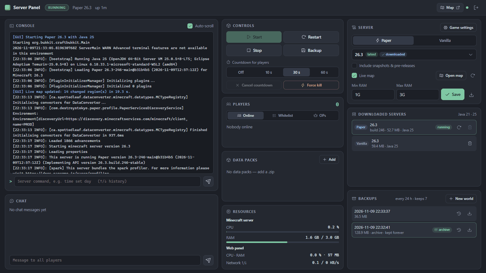
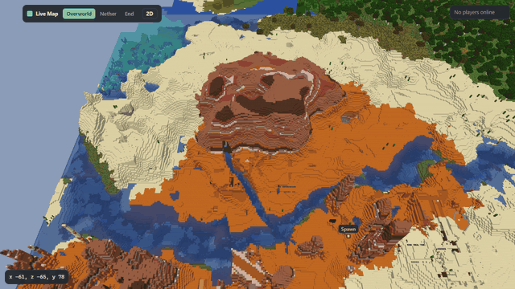
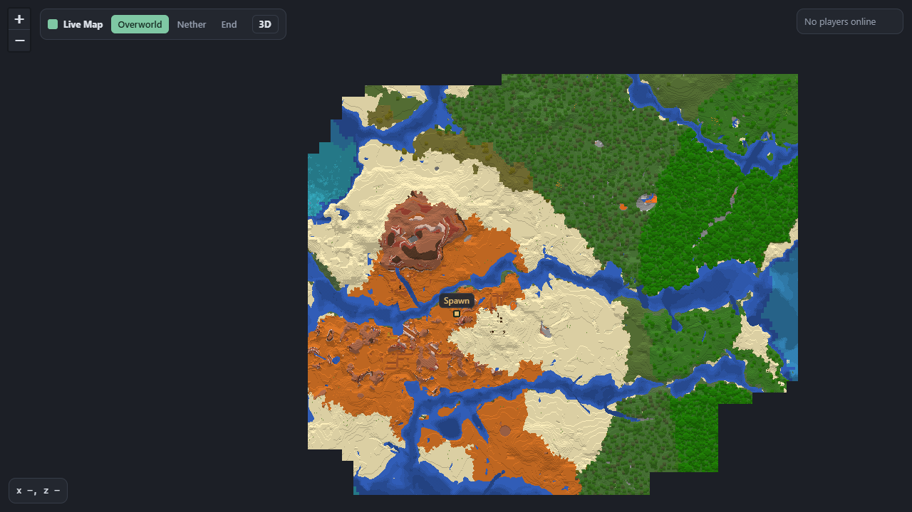
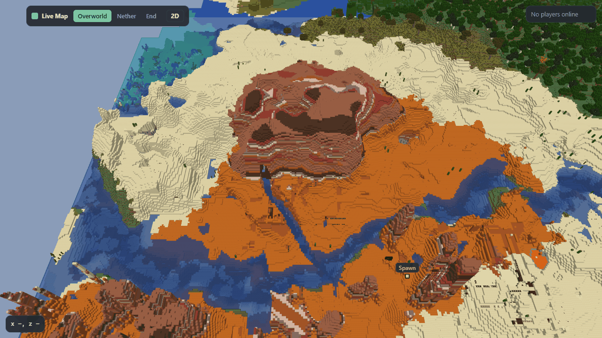

<h1 align="center">Minecraft Server Panel</h1>

<p align="center">
  <b>Run, manage and share a Minecraft Java server from your browser. Paper, Fabric or Vanilla, any version.</b><br>
  One-screen web panel · live 2D/3D map · live backups · Docker or plain Python
</p>

<p align="center">
  <a href="#quick-start-with-docker">Quick start</a> ·
  <a href="#features">Features</a> ·
  <a href="#configuration">Configuration</a> ·
  <a href="#development">Development</a>
</p>

<picture>
  <source media="(prefers-color-scheme: light)" srcset="screenshots/panel-light.png">
  
</picture>

A lightweight web interface for running a Minecraft Java Edition server: **Paper**
(performance-optimized, plugins, default), **Fabric** (mods) or **Vanilla** (Mojang). Start, stop, restart and back up the server,
follow the console and chat live, manage players, pick any version and share a live map, all from the
browser on a single screen. It runs as a Docker container or directly with Python.

## Live map in 2D and 3D

Every server type gets a live map on its own port that you can share with your players. Nothing runs
inside Minecraft: a small Rust renderer reads the world files and draws them with the real block
textures, so you can fly over your world block by block.

<p align="center">
  
</p>

| 2D overview | 3D view |
|---|---|
|  |  |

## Features

### Server

- 🟢 Start / stop / restart, with an optional in-game countdown for players (cancellable)
- 🧩 **Paper, Fabric or Vanilla, any version**: searchable version list from the PaperMC API, Fabric's
  meta API or Mojang's manifest, including snapshots/pre-releases if wanted. Paper/Vanilla jars are
  checksum-verified (SHA256/SHA1); switching the server type makes a backup of the world first
- ⚡ Paper is started with PaperMC's recommended JVM flags
- ⚠️ **Version change safety**: upgrading shows a hint, while **downgrading below the version your
  world was last saved with shows a warning** and asks for confirmation (also for imported worlds,
  read from `level.dat`). A missing Java runtime is flagged too
- 🗑️ Manage downloaded server jars (build, size, Java version; update Paper to its newest build or
  Fabric to its newest loader; delete old ones). The Mojang jar Paper downloads on first start is verified and offered as a Vanilla
  server too (hard link, no extra space)
- ☕ The matching Java runtime is selected per version (Docker image: Java 25 + 21 by default, 17/8 optional)

### Panel

- 🌐 Password login that stays logged in across panel restarts (30 days, renewed while used; a new
  password logs everybody out), light and dark theme
- 📜 Live console with command input and history (`↑`/`↓`), separate chat view and "say" box
- 👥 Player list with **Whitelist**, **OP** and **Banned** tabs (with ban reason): add/remove players,
  turn the whitelist on/off, one-click add for players the whitelist just turned away
- 🏆 **Hall of fame** on the live map: tier list by advancements, record podiums (play time, mobs,
  blocks mined, distance …), who has which advancement, a page per player
- 🖼️ **Server list icon**: the panel logo by default, or upload any image (cut and scaled to 64×64)
- 🙂 **Player profiles** with skin heads (from Mojang only): play time, first/last seen, last position,
  game mode, deaths; actions: game mode, teleport to spawn, heal, clear inventory, kick, ban, OP
- 🧩 **Mods (Fabric) and plugins (Paper)**: search and install from [Modrinth](https://modrinth.com)
  incl. required dependencies (SHA-512 verified), update check, upload your own `.jar`, switch on/off.
  Missing dependencies, the wrong Minecraft version and "players need this mod too" are flagged
- ⚙️ **Game settings** dialog for `server.properties`: MOTD, difficulty, game mode, max players,
  view/simulation distance (the biggest performance levers), spawn protection, flight, hardcore
- 📊 CPU and RAM of just the Minecraft server and the panel (plus container network in Docker),
  **TPS / ms per tick** and a history of the last hour (CPU, RAM, players, TPS)
- 📏 **Game rules** editor: read from the world (works with the renamed 26.x rules), common ones with a
  plain description, applied live while running
- 🪶 Lightweight: the panel needs about 55 MB RAM and does nothing while no browser is connected

### Live map

- 🗺️ **Works with every server type** (Vanilla, Paper, …) on its own port, to share with players.
  Reachable even while the server is stopped
- 🧱 Real Minecraft block textures and biome colours, in 2D and in a 3D view built from actual blocks
- 🌍 Overworld, Nether and End, zoom levels, world border, shareable links, live player positions
  with skin heads (polled only while someone has the map open; skins come from Mojang)
- 🕹️ 3D: fly with WASD where the camera looks (mouse wheel while flying sets the speed), hide
  water, plants, leaves, markers or fog, and look at any height through a movable slice of up to
  64 blocks (bar on the right edge); settings and the last view are remembered per browser
- 🕳️ Fair to players: the 3D view shows caves only as far as they are open to the sky (32 blocks
  into the cave by default); hidden caves and ores stay hidden, also in the map files. Optional
  (`MAP_ALL_CAVES=true`): every cave while the height slice is on
- 🦀 Rendered by `mapgen`, a small Rust program (< 1 MB) that reads the world files directly:
  incremental (only changed regions, an unchanged world takes milliseconds), low priority, limited threads

### Worlds and backups

- 💾 Live backups without stopping the server, optional schedule, retention, download, and
  **one-click restore** (the current world is backed up first)
- 🌱 **New world** button: archives the current world (`archive_*.zip`, never deleted automatically),
  optional seed, resets the live map
- ⬆️ **Upload a world** as `.zip` (from another server or a single-player save): it is checked, renamed
  to this server's world folders and added as a backup you can restore
- 📦 **Data packs**: uploaded `.zip` packs are kept in a library (`data/datapacks/`) and copied into
  the world. Switch them on/off per world (via `/datapack` while running, no restart; `level.dat` is
  edited while stopped), update the world copy, and pick which packs a **new world** starts with
  (in place before generation, so world-gen packs work)

## Quick start with Docker

```bash
cp .env.example .env        # set PANEL_PASSWORD (required) and TZ
docker compose up -d --build
```

Open <http://localhost:47318>, log in, choose **Paper** (default), **Fabric** or **Vanilla** and a version in
the **Server** card, and press **Start**. Nothing is downloaded until you pick a version. On the
first start the panel asks you to accept the [Minecraft EULA](https://aka.ms/MinecraftEULA).

| Port    | What | Share? |
|---------|------|--------|
| `47318` | Admin panel | No, keep private |
| `47319` | Live map | Yes, players can open `http://<your-host>:47319` |
| `25565` | Minecraft (first server) | Yes |
| `25566`–`25569` | Minecraft: additional servers created in the panel | Only the ones you use |

Everything persistent lives in `./data`:

```
data/
├── server/        # worlds, server.properties, logs, ops/whitelist ...
├── map/           # rendered live map tiles (can be deleted, re-rendered automatically)
├── jars/          # downloaded server jars, e.g. vanilla-1.21.4.jar, paper-26.3.jar
├── backups/       # backup_*.zip (rotated) and archive_*.zip (kept forever), or BACKUP_DIR
│   └── <id>/      # backups of an additional server
├── servers/<id>/  # additional servers: server/, settings.json (same layout as the first one)
├── servers.json   # names of all servers
├── sessions.json  # logins (only hashes of the session tokens)
├── players.json   # first/last seen per player (additional servers: servers/<id>/players.json)
└── settings.json  # server type, version, RAM, map toggle, version that last ran the world
```

The panel can run several independent servers side by side (e.g. one with data packs and one with
mods). The first one uses the folders above; each additional one gets its own folder, settings,
backups and game port. Jars, Java runtimes and the data pack library are shared. Each server
has its own live map (turn it on in its settings): each at `http://<host>:47319/s/<id>/`, with a server
switch on the map page; `http://<host>:47319/` opens the server you looked at last.

`docker compose down` stops the Minecraft server cleanly (it gets 90 s to save the world). The
container has a health check on the panel (`GET /api/health`).

## Running without Docker

Requires Python 3.10+ and Java on your `PATH` (Java 21 for 1.20.5–1.21.x, Java 25 for 26.x).

```bash
pip install -r requirements.txt
PANEL_PASSWORD=secret python -m app      # PowerShell: $env:PANEL_PASSWORD="secret"; python -m app
```

The panel runs on <http://localhost:47318>, the live map on <http://localhost:47319>, and data goes to `./data`.

## Configuration

Environment variables (see `.env.example`):

| Variable          | Default | Meaning |
|-------------------|---------|---------|
| `PANEL_PASSWORD`  | **required** | Panel password. The app refuses to start without it (the old name `MCGUI_PASSWORD` still works) |
| `TZ`              | `UTC`   | Time zone for logs and backup names, e.g. `Europe/Berlin` |
| `MC_FLAVOR`       | `paper` | Initial server type: `paper`, `fabric` or `vanilla` (can be changed in the panel) |
| `MC_VERSION`      | –       | Initial Minecraft version (can be changed in the panel) |
| `MIN_RAM` / `MAX_RAM` | `1G` / `3G` | Java heap (can be changed in the panel) |
| `MAP_ENABLED`     | `true`  | Live map (can be switched in the panel) |
| `MAP_THREADS`     | `2`     | CPU threads the map renderer may use |
| `MAP_INTERVAL`    | `60`    | Seconds between map update checks while the server runs |
| `MAP_CAVE_REACH`  | `32`    | How far (in blocks) the 3D map shows caves from where they open to the sky (0–256; overridden by `DATA_DIR/map_visibility.json`, see `PUT /api/map/visibility`) |
| `MAP_ALL_CAVES`   | `false` | `true`: the 3D map shows every cave while its height slice is on (reveals hidden caves to everyone who can open the map; overridden by `DATA_DIR/map_visibility.json`) |
| `MAP_TEXTURES`    | `true`  | Block textures on the map: the Minecraft client of the world's version is downloaded once from Mojang (~40 MB, stays on your server). `false`: map-item colours |
| `BACKUP_KEEP`     | `7`     | Number of backups kept |
| `BACKUP_INTERVAL_HOURS` | `24` | Automatic backup every N hours while the server runs (0 = off) |
| `BACKUP_DIR`      | `./data/backups` | Backup folder on the host (e.g. a NAS or second disk). Empty = default |
| `WORLD_UPLOAD_MAX_GB` | `4` | Largest world `.zip` that can be uploaded |
| `WEB_PORT_HOST` / `MC_PORT_HOST` / `MAP_PORT_HOST` | `47318` / `25565` / `47319` | Host ports (Docker Compose) |
| `SERVER_PORTS`    | `25565-25569` | Game ports handed out to additional servers (Docker publishes 25566–25569 1:1) |
| `EXTRA_JAVA`      | `21`    | Java runtimes added to the image besides 25 (`21 17 8` for old versions; rebuild needed) |
| `DATA_DIR`        | `data`  | Where server, jars and backups are stored |
| `WEB_HOST` / `WEB_PORT` / `MAP_PORT` | `0.0.0.0` / `47318` / `47319` | Bind address and ports inside the app |
| `JAVA_DIR`        | `/opt/java` | Directory with Java runtimes named by major version (`8/`, `17/`, ...) |

## Development

Work on the frontend without rebuilding the image: the dev override mounts `app/` from this folder.

```bash
docker compose -f docker-compose.yml -f docker-compose.dev.yml up -d
```

| You changed | What to do |
|---|---|
| HTML / CSS / JS (panel or map viewer) | Save and reload the browser. Minecraft keeps running |
| Python (`app/*.py`) | `docker compose restart` (restarts Minecraft too) |
| Rust renderer, Java versions, `requirements.txt` | `docker compose ... up -d --build` |

To make this the default, add `COMPOSE_FILE=docker-compose.yml;docker-compose.dev.yml` to `.env`
(`:` instead of `;` on Linux/macOS).

Tests:

```bash
pip install -r requirements-dev.txt
pytest                                   # panel (Python)
cd mapgen && cargo test && cargo build --release   # map renderer (Rust)
```

The tests need neither Minecraft, Java nor network access. Without Docker the panel finds the
renderer at `mapgen/target/release/mapgen`, on `PATH`, or via `MAPGEN_BIN`.

## Security notes

- The panel gives full console access (including `op`). Always set a strong `PANEL_PASSWORD`.
- If you expose it to the internet, put it behind a reverse proxy with HTTPS (Caddy, Traefik, nginx).
  Otherwise the password travels in plain text.
- The map port only serves the rendered map files, nothing else.
- Mods and plugins run with the server's rights. Install only ones you trust (Modrinth downloads are
  hash-checked, but that doesn't make a plugin safe).

## Credits

Icons: [Phosphor Icons](https://phosphoricons.com) (MIT License). Map viewer: [Leaflet](https://leafletjs.com) (BSD-2-Clause), [three.js](https://threejs.org) (MIT). Block textures are not part of this project: the panel downloads the Minecraft client from Mojang to your own server and the map reads them from there (without it, colours follow Minecraft's map items).
