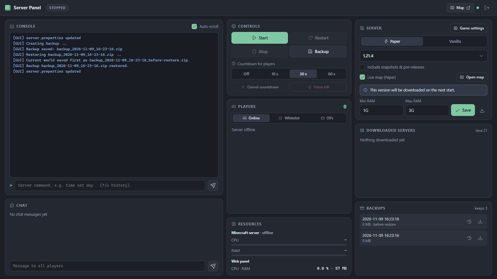

# Minecraft Server Panel [Vanilla & Paper]

A lightweight web interface for running a Minecraft Java Edition server, either **Paper**
(performance-optimized, default) or **Vanilla** (Mojang). Start, stop, restart and back up the server,
follow the console and chat live, manage players, pick any version and share a live map, all from the
browser on a single screen. It runs as a Docker container or directly with Python.



## Features

- 🌐 Web panel with password login, fits on one screen (scrolls on phones), light and dark theme
- 🟢 Start / stop / restart, with an optional in-game countdown for players (cancellable)
- 🧩 **Paper or Vanilla, any version**: searchable version list from the PaperMC API or Mojang's
  manifest, including snapshots/pre-releases if wanted. Jars are checksum-verified (SHA256/SHA1)
- ⚡ Paper is started with PaperMC's recommended JVM flags
- ⚠️ **Version change safety**: upgrading shows a hint, while **downgrading below the version your
  world was last saved with shows a warning** and asks for confirmation (also for imported worlds,
  read from `level.dat`). A missing Java runtime is flagged too
- 🗑️ Manage downloaded server jars (build, size, Java version; update Paper to its newest build; delete old
  ones). The Mojang jar Paper
  downloads on first start is verified and offered as a Vanilla server too (hard link, no extra space)
- 🗺️ **Live map for every server type** (Vanilla, Paper, …) on its own port, to share with players.
  Rendered by `mapgen`, a small Rust program (< 1 MB) that reads the world files directly: real
  Minecraft block textures and biome colours (2D and 3D), incremental (only changed regions, an unchanged world takes milliseconds), low priority,
  limited threads. Overworld, Nether and End, zoom levels, a 3D view in blocks, world border, shareable links, live player positions
  (polled only while someone has the map open). Reachable even while the server is stopped
- 📦 **Data packs**: uploaded `.zip` packs are kept in a library (`data/datapacks/`) and copied into
  the world. Switch them on/off per world (via `/datapack` while running, no restart; `level.dat` is
  edited while stopped), update the world copy, and pick which packs a **new world** starts with
  (in place before generation, so world-gen packs work), optionally with Minecraft's
  experimental feature packs (like "Experiments" in singleplayer)
- ⚙️ **Game settings** dialog for `server.properties`: MOTD, difficulty, game mode, max players,
  view/simulation distance (the biggest performance levers), spawn protection, flight, hardcore
- 👥 Player list with **Whitelist** and **OP** tabs: add/remove players, kick, turn the whitelist on/off,
  and one-click add for players the whitelist just turned away
- 💾 Live backups without stopping the server, optional schedule, retention, download, and
  **one-click restore** (the current world is backed up first)
- 🌱 **New world** button: archives the current world (`archive_*.zip`, never deleted automatically),
  optional seed, resets the live map
- 📜 Live console with command input and history (`↑`/`↓`), separate chat view and "say" box
- 📊 CPU and RAM of just the Minecraft server and the panel (plus container network in Docker)
- ☕ The matching Java runtime is selected per version (Docker image: Java 25 + 21 by default, 17/8 optional)
- 🪶 Lightweight: the panel needs about 55 MB RAM and does nothing while no browser is connected

## Quick start with Docker

```bash
cp .env.example .env        # set MCGUI_PASSWORD (required) and TZ
docker compose up -d --build
```

Open <http://localhost:47318>, log in, choose **Paper** (default) or **Vanilla** and a version in
the **Server** card, and press **Start**. Nothing is downloaded until you pick a version. On the
first start the panel asks you to accept the [Minecraft EULA](https://aka.ms/MinecraftEULA).

| Port    | What | Share? |
|---------|------|--------|
| `47318` | Admin panel | No, keep private |
| `47319` | Live map | Yes, players can open `http://<your-host>:47319` |
| `25565` | Minecraft | Yes |

Everything persistent lives in `./data`:

```
data/
├── server/        # worlds, server.properties, logs, ops/whitelist ...
├── map/           # rendered live map tiles (can be deleted, re-rendered automatically)
├── jars/          # downloaded server jars, e.g. vanilla-1.21.4.jar, paper-26.3.jar
├── backups/       # backup_*.zip (rotated) and archive_*.zip (kept forever), or BACKUP_DIR
└── settings.json  # server type, version, RAM, map toggle, version that last ran the world
```

`docker compose down` stops the Minecraft server cleanly (it gets 90 s to save the world). The
container has a health check on the panel (`GET /api/health`).

## Running without Docker

Requires Python 3.10+ and Java on your `PATH` (Java 21 for 1.20.5–1.21.x, Java 25 for 26.x).

```bash
pip install -r requirements.txt
MCGUI_PASSWORD=secret python -m app      # PowerShell: $env:MCGUI_PASSWORD="secret"; python -m app
```

The panel runs on <http://localhost:47318>, the live map on <http://localhost:47319>, and data goes to `./data`.

## Configuration

Environment variables (see `.env.example`):

| Variable          | Default | Meaning |
|-------------------|---------|---------|
| `MCGUI_PASSWORD`  | **required** | Panel password. The app refuses to start without it |
| `TZ`              | `UTC`   | Time zone for logs and backup names, e.g. `Europe/Berlin` |
| `MC_FLAVOR`       | `paper` | Initial server type: `paper` or `vanilla` (can be changed in the panel) |
| `MC_VERSION`      | –       | Initial Minecraft version (can be changed in the panel) |
| `MIN_RAM` / `MAX_RAM` | `1G` / `3G` | Java heap (can be changed in the panel) |
| `MAP_ENABLED`     | `true`  | Live map (can be switched in the panel) |
| `MAP_THREADS`     | `2`     | CPU threads the map renderer may use |
| `MAP_INTERVAL`    | `60`    | Seconds between map update checks while the server runs |
| `MAP_TEXTURES`    | `true`  | Block textures on the map: the Minecraft client of the world's version is downloaded once from Mojang (~40 MB, stays on your server). `false`: map-item colours |
| `BACKUP_KEEP`     | `7`     | Number of backups kept |
| `BACKUP_INTERVAL_HOURS` | `24` | Automatic backup every N hours while the server runs (0 = off) |
| `BACKUP_DIR`      | `./data/backups` | Backup folder on the host (e.g. a NAS or second disk). Empty = default |
| `WEB_PORT_HOST` / `MC_PORT_HOST` / `MAP_PORT_HOST` | `47318` / `25565` / `47319` | Host ports (Docker Compose) |
| `EXTRA_JAVA`      | `21`    | Java runtimes added to the image besides 25 (`21 17 8` for old versions; rebuild needed) |
| `DATA_DIR`        | `data`  | Where server, jars and backups are stored |
| `WEB_HOST` / `WEB_PORT` / `MAP_PORT` | `0.0.0.0` / `47318` / `47319` | Bind address and ports inside the app |
| `JAVA_DIR`        | `/opt/java` | Directory with Java runtimes named by major version (`8/`, `17/`, ...) |

## Development

Work on the frontend without rebuilding the image: the dev override mounts `app/` from this folder.

```bash
docker compose -f docker-compose.yml -f docker-compose.dev.yml up -d
```

| You changed | What to do |
|---|---|
| HTML / CSS / JS (panel or map viewer) | Save and reload the browser. Minecraft keeps running |
| Python (`app/*.py`) | `docker compose restart` (restarts Minecraft too) |
| Rust renderer, Java versions, `requirements.txt` | `docker compose ... up -d --build` |

To make this the default, add `COMPOSE_FILE=docker-compose.yml;docker-compose.dev.yml` to `.env`
(`:` instead of `;` on Linux/macOS).

Tests:

```bash
pip install -r requirements-dev.txt
pytest                                   # panel (Python)
cd mapgen && cargo test && cargo build --release   # map renderer (Rust)
```

The tests need neither Minecraft, Java nor network access. Without Docker the panel finds the
renderer at `mapgen/target/release/mapgen`, on `PATH`, or via `MAPGEN_BIN`.

## Security notes

- The panel gives full console access (including `op`). Always set a strong `MCGUI_PASSWORD`.
- If you expose it to the internet, put it behind a reverse proxy with HTTPS (Caddy, Traefik, nginx).
  Otherwise the password travels in plain text.
- The map port only serves the rendered map files, nothing else.

## Credits

Icons: [Phosphor Icons](https://phosphoricons.com) (MIT License). Map viewer: [Leaflet](https://leafletjs.com) (BSD-2-Clause), [three.js](https://threejs.org) (MIT). Block textures are not part of this project: the panel downloads the Minecraft client from Mojang to your own server and the map reads them from there (without it, colours follow Minecraft's map items).

## Planned

- Panel: [TODO_DASHBOARD.md](TODO_DASHBOARD.md), [DEV_TODO_DASHBOARD.md](DEV_TODO_DASHBOARD.md)
- Live map: [TODO_LIVEMAP.md](TODO_LIVEMAP.md), [DEV_TODO_LIVEMAP.md](DEV_TODO_LIVEMAP.md)
